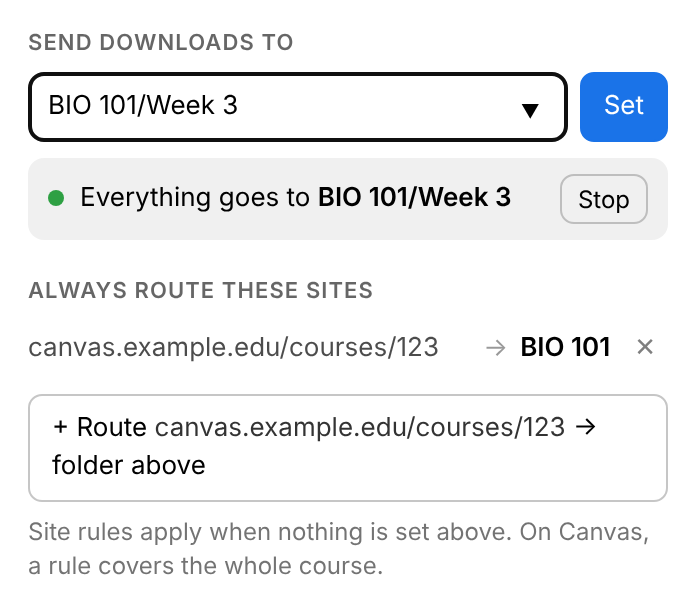

#  Download Organizer

A Chrome extension that sends downloads straight to the folder you pick, so files never pile up
in Downloads waiting to be dragged somewhere. I built it to keep course files sorted while
studying: set a folder once, or teach it that everything from a site, or from one Canvas course,
belongs in a particular folder.



## What it does

- **Active folder.** Type a folder (nested folders like `BIO 101/Week 3` work) and every download
  goes there until you press Stop. A green **ON** badge on the toolbar icon makes it obvious
  while it's active.
- **Site rules.** "Route this page" remembers the current site, and any download from it lands in
  the folder you choose. On Canvas the rule covers the whole course, so each course's files sort
  themselves.
- **Recent folders** are suggested as you type, and a name clash becomes `notes (1).pdf`, the
  same as Chrome's normal behavior.

## How it works

- The service worker listens to
  [`chrome.downloads.onDeterminingFilename`](https://developer.chrome.com/docs/extensions/reference/api/downloads#event-onDeterminingFilename)
  and suggests `<folder>/<filename>` with `conflictAction: "uniquify"`. Chrome only lets
  extensions choose paths inside the Downloads folder, so every folder is a subfolder of it.
- An active folder wins over site rules; among rules, the newest match wins.
- Rules match on boundaries, not substrings: a rule for `example.com` covers `files.example.com`
  but not `notexample.com`, and a rule for course `123` doesn't catch course `1234`. Each
  download's URL, final URL after redirects, and referrer are checked, because Canvas serves
  course files from a separate file host and only the referrer names the course.
- Folder names are made safe on every OS before they're used: `.` and `..` segments are dropped
  so a path can't climb out of Downloads, characters Windows forbids are replaced (`BIO 101:
  Week 3` becomes `BIO 101 - Week 3`), trailing dots and spaces are trimmed, and reserved names
  like `con` get a suffix.
- All of that logic lives in [`extension/lib.js`](extension/lib.js), plain functions with no
  Chrome APIs, shared by the service worker, the popup and the tests.

## Privacy and permissions

Nothing leaves your browser: the extension makes no network requests, and its settings live in
`chrome.storage.local`.

| Permission | Why |
|---|---|
| `downloads` | To choose where each download is saved |
| `storage` | To remember the active folder, rules and recent folders |
| `activeTab` | To read the current tab's address when you open the popup, so "Route this page" knows what to match. It grants nothing in the background and no browsing history. |

## Install

1. Download or clone this repository.
2. Open `chrome://extensions`, turn on **Developer mode**, choose **Load unpacked**, and select the
   `extension/` folder.

## Development

```sh
npm test                    # unit tests for the matching and folder-name rules (no dependencies)

npm install                 # Playwright, for the browser test
npx playwright install chromium
npm run e2e                 # loads the extension into Chromium and routes a real download
npm run screenshot          # same, and refreshes docs/popup.png
npm run package             # zips extension/ into dist/ for the Chrome Web Store
```

The browser test starts a local file server, loads the unpacked extension into a fresh Chromium
profile, sets an active folder, checks the toolbar badge, downloads a file through
`chrome.downloads`, and asserts it was saved under that folder. CI runs the unit tests and
packaging on every push.
